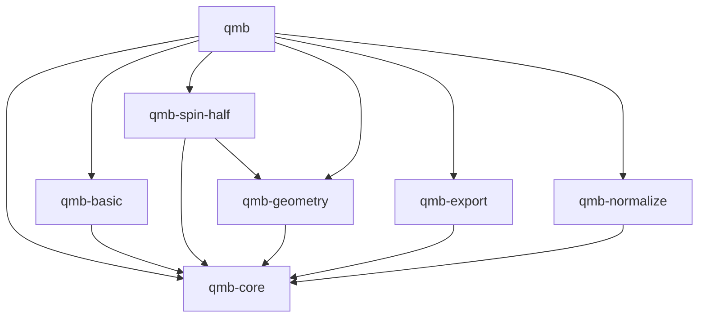

# qmb-rs 実装計画

更新日: 2026-10-26

## 1. 目的と位置付け

本書は、[要件](requirements.md)、[アーキテクチャ概要](architecture.md)、および[初期版の提供範囲と完成条件](design/initial-release.md)に基づき、合意した crate 分割・実装順序と進捗を記録する。段階1〜4は実装済み、段階5以降は未実装である。係数型のリファクタリングと qmb-normalize への分離は実装済みである。

`qmb-core` は抽象契約と共通の代数処理を担当し、具体的な代数は専用 crate に分離する。文書中の「代数 core」は `qmb-core` を指す。共通表現と基本操作を同じ crate が所有し、内部の責任は module で分離する。

Step 2 の局所構造と演算能力の分離、共通パーツと項型、基底 trait、評価経路、所有権、反復的な評価・破棄の方針は採用済みであり、本書の実装内容と完了条件に含める。Step 3 の採用済みの型・共有・空間保持・エラー・評価方針は [Step 3 の実装方針](step-3-design.md)にまとめる。Step 4 の採用済み方針と受入条件は [Step 4 の合意事項](step-4-decisions.md)にまとめる。それ以降の API の詳細・数値 backend・追加依存は、各段階で設計する。数学的契約と初期版の提供範囲は既存文書に従う。

## 2. crate の責任と依存関係

係数型の採用方針を反映し、計画上は以下の7 crate を `crates/` 以下に配置する。package 名は表の名称とする。現時点で実装済みの crate は `qmb-core`・`qmb-spin-half`・`qmb-basic`・`qmb-geometry`・`qmb-normalize`・`qmb` であり、`qmb-export` は未実装である。

| crate | 責任 | workspace 内の通常依存 |
| --- | --- | --- |
| `qmb-core` | 数値精度・局所構造・primitive・基底の契約、有限線型結合、局所・複合式木、ジェネリックな Index の照合・自由度・Hilbert 空間、局所式の配置・束縛、評価、基底展開・座標取得・写像の表現係数 | なし |
| `qmb-basic` | UUID による具体型 `Id128` と、seed 指定不要の new・Default による発行 API | `qmb-core` |
| `qmb-spin-half` | spin-1/2 の局所構造・primitive・局所規則・基底、Heisenberg・Neel の構築 utility | `qmb-core`、`qmb-geometry` |
| `qmb-geometry` | Geometry・Site、Chain、近接関係、自由度と Site の対応付け、配置用 Index 発行の補助 | `qmb-core` |
| `qmb-export` | 外部数値ライブラリへの密・疎変換、空間・基底・精度情報との対応付け | `qmb-core` |
| `qmb-normalize` | norm・状態の正規化・正規化期待値と NormalizationError を提供する。std を利用でき、実数型 R に Float を要求する | `qmb-core` |
| `qmb` | 各 crate と構築 utility の再公開、利用例、縦断的な結合テスト | 上記6 crate |

以下の矢印は「依存する」を表す。

将来の別の具体的代数も、専用 crate として `qmb-core` の契約を実装し、共通型を直接利用できる。初期版には未実装の代数用 crate を作らない。core は具体的代数を列挙せず、独自代数も同じ式木・評価機構で扱う。core の通常依存に具体的代数・Geometry・数値 backend を持ち込まない。

`qmb` は core・共通代数処理・basic の具体型 Id128・spin-1/2・Geometry を再公開する。既定の `normalize` feature が qmb-normalize と Norm・Normalize・NormalizedExpectation・NormalizedExpectationIn 拡張 trait を有効にし、prelude からも提供する。`--no-default-features` では正規化の拡張を除く代数 API を利用できる。旧 `qmb/libm` は `normalize` の互換 alias とし、`qmb-core/libm` は削除した。core は内積・期待値・norm squared・スカラー除算を保持し、単独で no_std + alloc を維持する。

数値 export は後続の `export` feature で有効にし、代数計算だけでも利用できる構成とする。初期版の export は一つの crate にまとめ、backend ごとの crate 分割は行わない。

## 3. 抽象契約と共通実装の境界

### 3.1. qmb-core

共通の代数処理を追加した後も `no_std + alloc` を維持する。Step 2 は既存の依存と標準機構で実装し、新しい production 依存や feature は追加しない。

Step 3 以降の自由度・空間・配置済みの式は Index 型をジェネリックに扱い、同じ Index を照合できることを契約とする。UUID の表現・発行・乱数源は core に置かず、具体的な Index 型と seed 指定を要求しない発行 API を `qmb-basic` に置く。`qmb-basic` は core に依存し、core は basic に依存しない。Geometry の発行補助は生成時にのみ `I: Default` を要求し、`I::default()` で新規 Index を発行する。専用の生成 trait は追加せず、UUID への依存を必須にしない。詳細は [Index の契約](design/index.md)に従う。

基本自由度は Index と局所構造を持つ `HilbertSpace` の葉（Factor）に統合し、独立した `Dof` 型は設けない。葉と Tensor を同じ空間型で扱い、構築時に保持した葉を合成・局所式の配置先指定・部分系判定に再利用する。詳細は [Hilbert 空間の再帰構造](design/hilbert-space.md)に従う。

局所構造の次元・一致条件・primitive の関連付け、内積・Product・Act・随伴・trace・恒等元、および基底の展開・順序番号・列挙の契約を置く。Act は状態 primitive が演算子 primitive の作用を受ける能力とする。

Step 2 で `LocalStructure` から型引数 `T` と演算能力の制約を外し、状態・演算子の関連型と次元だけを定める。恒等演算子の規則は `Identity<C>: LocalStructure` に分離する。`LocalState<L, C>`・`LocalOperator<L, C>` は維持し、演算能力と入出力の対応は各メソッドで要求する。保持・係数計算を伴わない遅延構築・`map` に数値制約を付けず、primitive の最小限の数値制約を維持する。全能力をまとめた係数 trait は導入しない。

局所契約・有限線型結合、局所・複合式、Index・空間、配置・束縛、評価、および基底処理を module で分離する。基底 trait と primitive 一つの展開から、式全体の展開・複合基底・座標取得までを core が担当する。外部の数値コンテナ型は必須 API に持ち込まない。

Step 1 の局所規則と局所基底展開は `LinearCombination` を返す。Step 2 でもこの薄い有限線型結合型を維持する。`ScaleExpr`・`SumExpr`・`ProductExpr`・`ActExpr`・`AdjointExpr` を共通パーツとして実装し、局所式の各 variant がこれらを保持する。線型結合の保持には `SumExpr<ScaleExpr<P, C>>` を使い、項順序・重複・零係数と空・単一要素のコンテナ割り当て特性を維持する。

共通パーツは `expr::parts` で型と保持内容を公開し、式ハンドルを crate root から再公開する。式の節点 enum と共有の内部表現は非公開とする。項型 `Term<P, C>` は `ScaleExpr<P, C>` の別名にし、要素フィールドを `operand` に統一する。既存の線型結合の構築・走査 API は維持し、走査の実装を `SumExpr` へ集約する。演算 trait の関連型 `Term` は係数を含まない要素型であり、この項型とは区別する。

Product・Act・随伴の trait は係数全体 `C` を型引数、返却要素を関連型 `Term` とし、出力を `LinearCombination<Self::Term, C>` に限定する。Act の演算子型も関連型 `Operator` とする。数値制約は各 `impl<C>` に置き、演算 trait を局所式・局所構造に依存させない。局所規則と恒等演算子は対応する primitive の線型結合を返し、局所基底展開も選択基底の primitive の線型結合を返す。式木側が所有権付きの `map` で要素を変換し、共通 constructor で和・スカラー倍として取り込む。変換自体に要素・係数の `Clone` は要求しない。

core の局所構造・恒等演算子・演算 trait と関連型の制約、項型・`map`・共通 constructor、spin-half と非公開の局所代数・テスト・doc test の整備は Step 2 に含める。`Basis<P, C>` は維持し、`StateBasis`・`OperatorBasis` の定義・再公開・実装宣言・利用を削除する。利用側は `L: LocalStructure` と `Basis<L::State, C>` または `Basis<L::Operator, C>` を直接要求する。次元取得 API からは不要な `T` を外し、基底の完全性・線型独立性・要素数の契約は維持する。`SzBasis`・`CartesianBasis`・`LadderBasis` は線型結合を返す契約を維持し、局所式への取り込みも同じ Step 2 で検証する。段階1の完了をこの整備済みという意味にしない。

不変な式節点・primitive は式ハンドルの `Arc` を基本として共有する。既存のハンドルを再利用した箇所で部分式を共有し、式の合成や `Clone` で木全体を複製しない。同形の式の自動検出・共有は行わない。共通評価は線型性・共役線型性・合成則から primitive の規則へ委譲する。状態式の `act` は `Act` 節点による遅延構築、`evaluate` は基底を指定しない局所規則による評価とする。通常の作用・内積・trace に、指定基底への展開や行列化を必須としない。

評価器は状態評価・演算子の作用・演算子項の走査を分担し、状態への作用評価に `Product` 能力を要求しない。評価と、最後の所有者になった式節点の破棄には明示的な作業スタックを使い、式の深さに比例した関数再帰を避ける。式同士の二項演算子は所有値・借用値の4通りを提供し、所有ハンドルを移動、借用ハンドルは共有参照を複製する。名前付きメソッドは共有借用を基本とする。

### 3.2. 具体的代数

`qmb-spin-half` は primitive・局所規則・具体的基底を実装し、core の共通型を直接利用できる。具体的代数やユーザに独自の式木・evaluator の実装を要求しない。

初期版は一つの系を同じ局所構造型 `L` の基本因子で構成し、その系では対応する primitive 型を共通にする。独自代数は `L` の別実装として別の系で単独利用する。異種局所構造の混在・合成と、そのための型消去・保持方式の設計は後続へ延期する。

### 3.3. Geometry・export・利用窓口

Geometry は利用者が指定した局所構造型で Site・関係・配置を保持し、具体的代数の規則は実装しない。Heisenberg Hamiltonian と Neel 状態の構築補助は `qmb-spin-half` の utility に置き、`qmb` は再公開と利用例を担当する。

Step 4 の Geometry は、生成時に利用者が `L: LocalStructure` を指定し、Site ごとの `HilbertSpace<I, L>` と全 Hilbert 空間を保持する。既存の HilbertSpace を Site 順に渡す経路と、Site 数・各 Site 共通の局所自由度数から空間を構築する経路を提供する。生成後は保持済みの全 Hilbert 空間を取得でき、取得時に Index を再発行しない。詳細は [Step 4 の合意事項](step-4-decisions.md)に従う。

代数的な座標取得と写像の表現係数の生成は `qmb-core`、外部のベクトル・行列型への格納は `qmb-export` が担当する。core での局所式への Index 付与・束縛と、Geometry での自由度と Site の対応付けを区別する。

`qmb-export` は公開された基底列挙・作用・座標取得を使い、非公開の式木へアクセスしたり、評価規則を再実装したりしない。非正規直交基底では内積値と座標を区別する。演算子の export に演算子基底への全展開を必須としない。

## 4. 実装順序と完了条件

crate ごとに完成させるのではなく、抽象契約と具体的代数を往復しながら動作範囲を広げる。

| 段階 | 実装内容 | 完了条件 |
| --- | --- | --- |
| 1. 抽象契約と具体例（実装済み） | `qmb-core` と `qmb-spin-half`。能力 trait、有限線型結合、spin の局所規則・基底 | core の公開契約だけで spin の積・作用・随伴・内積・trace・基底展開を記述できる |
| 2. 局所式と評価・既存 API の整備（実装済み） | 3.1 節の採用済み方針に従い、局所構造と演算能力の分離、共通パーツ・項型の統合、関連型・map・constructor、局所式・共有・反復的な評価と破棄を core・spin-half・テストへ実装する。基底の marker trait を削除し、Basis を直接使う | 両 marker trait の定義・再公開・実装宣言・利用がコード・テスト・doc test から除去される。数値能力のない型での式構築、Product のない演算子の作用評価、所有値・借用値の4通り、長い式の評価・破棄、規則・基底の数学的結果、map の保持特性、入力の不変性・共有、空・単一項のコンテナ無確保を検証する |
| 3. 空間と複合評価（実装済み） | [採用済み方針](step-3-design.md)に従い、`qmb-core` にジェネリックな Index の照合、HilbertSpace の葉と入れ子 Tensor、互換性・部分系判定、配置・束縛、複合作用・内積・期待値・随伴・full trace・導出操作。`qmb-basic` に UUID の具体型と発行 API | Geometry なしで同種の複数因子を評価でき、zero・identity の空間保持、明示空間の優先、早期のエラー検出、深い空間の反復的な走査・破棄、総次元 overflow と空間構築の分離を検証できる。core は独自 Index 型で動作し、basic は seed 指定なしで発行できる |
| 4. 最初の縦断例と導出操作の補完（実装済み） | [合意事項](step-4-decisions.md)に従い、Geometry・Chain・近接関係、basic の Id128 への改名、spin-half の Heisenberg・Neel utility、qmb の再公開・縦断例を実装する。core の局所式・複合式へ norm・正規化・正規化期待値と libm feature を追加する。bra・内部ラベルは初期版に導入しない | 行列化せず open chain の期待値 `J(L−1)/4` を得る。Neel の norm、zero-norm の拒否、0-site と periodic の小規模規約も確認する |
| 5. 縮約・座標取得 | `qmb-core` に partial trace、複合基底、式の展開・再展開・係数取得、写像の表現係数 | 残存空間、mixed-radix 順序、非正規直交基底、入力ごとの共役指定を正しく扱える |
| 6. 数値接続と受入確認 | `qmb-export`。密ベクトル・密行列、続いて疎ベクトル・疎行列を接続し、利用例を完成させる | 代数計算・表現係数・密・疎の各経路が一致し、疎変換が密表現を中間生成せず、初期版の完成条件を満たす |

段階1で非公開テスト用の別の有限次元局所代数も用意し、契約が spin 固有になっていないことを確認する。段階2以降、その代数だけで構成する独立した系に対し、共通式・複合評価・基底展開・export の検証を順次追加する。spin と同じ系に混在させる検証は初期版に含めない。抽象化の問題を最終段階まで持ち越さない。

段階4の解析的期待値は実数の `J` と `L >= 1` を対象とし、0-site は Hamiltonian と期待値が zero となる特例として検証する。各段階の詳細な能力・受入条件は既存の設計文書に従い、表に記載していない導出操作も初期版の範囲から除外しない。

### 4.1. 段階1の実装・検証状況

2026-10-21 に段階1の完了条件を満たすことを確認した。

- `qmb-core` に局所構造・演算・基底の trait と有限線型結合を実装した。局所構造は型ごとの固定次元・静的な関連付けを採用し、実行時の定義パラメータや別実装型間の定義照合は対象外とした。
- `qmb-spin-half` に状態・演算子 primitive、局所規則、状態基底と二種類の演算子基底を実装した。通常依存は `qmb-core` のみである。
- 単精度・倍精度で局所積36組、作用12組、内積・随伴・trace・基底展開を独立した行列と照合した。core の公開 API だけを使う三次元局所代数、非正規直交基底、操作ごとの最小限の型制約もテストした。
- 既存の direnv 環境（Rust 1.98.0）で workspace の全26テスト（doc test 含む）、format check、Clippy、警告をエラーとするドキュメント生成が成功した。
- 両 crate は `no_std` を指定し、通常依存で `std`・`libm` が有効になっていないことを確認した。宣言した MSRV（Rust 1.85）での実行と、`std` のない target 向けビルドは、対応環境がないため未確認である。

### 4.2. 段階2の実装・検証状況

2026-10-22 に段階2の完了条件を満たすことを確認した。

- 共通パーツ、薄い線型結合と `map`、局所状態・演算子式、構築・共有・評価と導出操作を `qmb-core` に実装した。局所構造と演算能力を分離し、core・spin-half・テスト・doc test を新しい関連型と項型へ移行した。基底の marker trait はコードから削除した。
- spin と独立した三次元代数の局所式を、単精度・倍精度の独立した行列計算と照合した。非正規直交基底からの取り込み、作用・内積・随伴・trace・期待値・導出操作、所有値・借用値の演算子構文を検証した。
- 数値演算を持たない型での構築、Clone を持たない primitive と借用値の保持、Num・除算・剰余を要求しない係数処理、Product のない演算子の作用評価、部分式の共有、項順序・重複・零係数、空・単一項のコンテナ無確保を確認した。精度・局所構造の混在と非 Send な primitive は compile-fail テストで検証した。
- 2万段の積・作用・和・スカラー倍・随伴を含む式を、128 KiB のスタック上で評価・破棄した。最後の所有者になった節点の反復解放と、共有先が残る部分式の保持を確認した。
- 既存の direnv 環境（Rust 1.98.0）で全46テスト（doc test 含む）、format check、Clippy、警告をエラーとするドキュメント生成が成功した。`no_std + alloc` を維持し、新しい通常依存・feature は追加していない。通常依存の `std`・`libm` が有効でないことも確認した。MSRV（Rust 1.85）での実行と `std` のない target 向けビルドは未確認である。

### 4.3. 段階3の実装・検証状況

2026-10-23 に段階3の完了条件を満たすことを確認した。

- `HilbertSpace<I, L>`、`State<I, L, C>`・`Operator<I, L, C>` と配置・束縛・複合評価、`qmb-basic` の UUID v4 Index を実装した。Index の照合は標準の `Eq` を使い、core は UUID・乱数源に依存しない。
- Spin-half の三因子系と、非公開の三次元代数の二因子系を、単精度・倍精度の独立した Kronecker 行列計算と照合した。非正規直交基底からの取り込み、空間・束縛・エラー・所有権、総次元の overflow、2万段の空間・状態・演算子の128 KiB スタック上での処理も検証した。
- Rust 1.98.0 の direnv 環境で全70テスト（doc test 含む）、format check、Clippy、警告をエラーとするドキュメント生成を確認した。MSRV（Rust 1.85）での実行と `std` のない target 向けビルドは対応環境がないため未確認である。詳細は [Step 3 の検証状況](step-3-design.md#12-実装検証状況)に記録する。

### 4.4. 段階4の実装・検証状況

2026-10-25 に段階4の完了条件を満たすことを確認した。

同日のリファクタリングで、負符号の規約 `−Σ(Jx Sx_i Sx_j + Jy Sy_i Sy_j + Jz Sz_i Sz_j)` の XYZ utility を追加した。Heisenberg は等方結合として XYZ に委譲する。異方的な XYZ の行列照合と等方極限のテストも追加した。エラーの定義・表示・変換は既存の thiserror に揃え、geometry・spin-half からも直接利用する。

- `qmb-geometry` に不変な Site 配置、Chain、open / periodic 境界、`NearestNeighborRelation` と借用による全組合せ・位置対応の Index ペア列挙を実装した。新規発行は `I::default()` に限定し、既存空間の構造・Index・共有と明示的な全空間の因子順を保持する。具体的な構築 API は [Step 4 の実装 API](step-4-decisions.md#10-実装した構築-api-と利用例)を参照する。
- basic の具体型を `Id128` に改名し、UUID v4 の発行・Default・Clone / Copy・比較・hash の契約と型別名を移行した。core に Index 発行 trait は追加していない。
- spin-half の `utility::{xyz, heisenberg, neel}` と qmb の再公開・実行可能な利用例を追加した。空・単一・二 Site と奇数 periodic、両開始向き、単精度・倍精度の解析的期待値と norm を検証した。Heisenberg の作用・Hermiticity は独立した Pauli 行列の Kronecker 積とも照合した。
- core の局所式・複合式へ norm squared、libm feature 下の norm・正規化、平方根を使わない正規化期待値、共通エラーを追加した。非正規直交な三次元代数、相殺による zero norm、内積の共役線型性・線型性、明示空間の優先と最小限の数値制約も確認した。bra・内部ラベルは導入していない。
- Rust 1.98.0 で workspace の全 feature 有効・default feature 無効のテスト、format check、Clippy（全 target・全 feature、警告をエラー化）、警告をエラーとするドキュメント生成が成功した。例は既定構成と default feature 無効の両方で期待値 `1.25` を返した。
- core・geometry の `no_std + alloc` と通常依存を確認した。追加の外部依存は合意済みの libm（検証時 `0.2.16`）のみで、無効時に通常依存の std・libm を有効化しない。MSRV（Rust 1.85）と専用 no_std target は、対応ツールチェーン・target ライブラリが環境にないため未確認である。

## 5. 検証方針

- `qmb-core` では共通型・契約・評価、具体的代数では局所規則、`qmb` では crate を横断する利用を検証する。
- `qmb-core` の拡張性は integration test から公開 API だけを使って確認する。通常依存に具体的代数を追加しない。
- Step 3 では UUID に依存しないテスト用 Index 型で core の照合・重複検出・空間と式の整合性を検証し、具体的な生成方式と分離されていることを確認する。basic の UUID 発行と複製による同一性の保持は別途検証する。
- Step 3 の具体的な実装順序・受入条件は [Step 3 の実装方針](step-3-design.md#10-実装順序と検証条件)に従う。異なる括り方、非連続な部分系、束縛の合成と上書き、空間を保持する zero・identity、総次元が `usize` を超える空間、構築の遅延性と深い空間・式の処理を含める。
- 小規模行列を独立に定義し、製品用 export の実装前から参照計算に使う。単精度・倍精度それぞれで `atol`・`rtol` を明示する。
- 非正規直交基底、重複 Index、空間・精度の不整合、不正な縮約・配置、zero-norm、空・単因子・入れ子を検証する。
- 入力の不変性、共有実体の再利用、不要な局所規則が呼ばれないことを検証し、lazy 評価と不要な deep copy の抑制を確認する。source の自動保持、式の構造比較・表示は受入条件に含めない。
- Step 2 で長い積・作用のチェーンの評価・破棄と、共有先が残る部分式の保持を検証する。性能上の合格条件は共有、不要な primitive 複製の抑制、空・単一項のコンテナ無確保とする。map 全般の無確保や特定の実行時間は保証しない。
- 各段階で対象テストを実行した後、workspace の test・format check・Clippy で確認する。最終段階では export 無効と全 feature 有効の両構成を確認する。
- 初期版の代表シナリオを実行可能な利用例として提供する。

## 6. 未決事項と延期するもの

Step 2 の局所構造と演算能力の分離、共通パーツの公開、項型と走査の統合、基底の marker trait の削除と `Basis` の直接利用、評価の分担・メソッドごとの制約、所有権、反復的な評価・破棄と性能上の合格条件は採用済みとする。非公開の補助型・作業領域・数値演算を呼ぶ位置での制約は、この方針と検証条件の範囲で実装時に定める。

Step 3 では、core の Index のジェネリック化と basic の UUID 発行、Dof の葉への統合、型 `L` による固定定義、`Arc` による空間・式の共有、反復的な走査・破棄、次元取得時の overflow 検出、常に空間を持つ状態、ハンドルに集約する演算子の束縛、fallible な複合操作、目的別の評価経路を採用済みとする。詳細は [Step 3 の実装方針](step-3-design.md)に従う。

Step 3 の具体型は `HilbertSpace<I, L>`・`State<I, L, C>`・`Operator<I, L, C>` とし、Index には必要なメソッドで標準の `Eq` を要求する。非公開の節点・作業スタック、`SpaceError`・`ExpressionError`、basic の UUID v4 による具体型・発行 API も実装した。API と検証結果は [Step 3 の実装方針](step-3-design.md#11-実装した-api-と後続事項)に記録する。Norm・正規化・正規化期待値の数値 API は [Step 4 の合意事項](step-4-decisions.md)に従って実装する。bra は初期版では導入せず、braket は内積で計算する。Partial trace・基底処理は段階5、数値 backend は段階6で具体化する。実行時の局所構造パラメータ・異なる実装型間の定義照合は後続へ延期する。速度比較・追加の割り当て最適化も別途検証する。新しい production 依存は、採用理由と用途を具体化してから確認する。

初期版は同種局所構造・ordinary・単一スレッドを対象とする。異種局所構造の混在・合成、Graded・fermion、source の自動保持・式の構造比較・表示、保存・復元、個別の簡約ルール、キャッシュ、並列化、追加 Geometry、ML・tensor network などの接続は既存の初期版設計に従って延期する。これらのための crate は先に作らない。不変実体の共有と後続機能の数学的契約は維持する。

State・Operator・Structure・Space の管理方法は、将来必ず再検討し、より適切な設計へリファクタリングする。所有・共有・関連付け、および Geometry と空間の依存関係を見直すことを後続の必須課題とし、現行設計を最終形として固定しない。具体的な設計と実施時期は後続で決定する。この見直しを Step 4 の完了条件には追加しない。詳細は [アーキテクチャの将来の必須課題](architecture.md#10-将来の必須課題)に従う。

同じリファクタリングで、core の係数型と数値能力を整理する。2026-10-25 の方針変更により `num-complex`・`num-traits` は core に含め、不足する能力 trait を `Complex<f32>`・`Complex<f64>` に直接実装し、必要な操作で必要な trait bound を課す。零・単位元には num-traits の Zero・One をそのまま使い、付随する能力も受け入れる。また、LocalStructure の必要性、操作的量子論に基づく Operator・State の一般の演算子の特別な形としての整理、Index と Grading だけによる HilbertSpace の構成、その構成から Grading を除いた Chain の内部表現について、議論して設計上の結論と根拠を記録する。これら五つの課題を必須課題とし、Step 4 の完了条件には追加しない。

係数型の残る推奨案は同日にすべて採用した。係数全体 C への型引数の移行、個別の共役・実数値取得・実係数の埋め込み・純虚係数生成、qmb-normalize の拡張 trait、標準 Complex の左スカラー倍の個別実装と任意の C の scaled(c)、正規化期待値の純実分母の処理の維持を実装する。追加 provider は導入しない。移行順序と検証基準は [係数型の採用方針](refactoring-coefficient-proposal.md)に従う。

## 7. 係数型のリファクタリング

**完了（2026-10-26）**。実装・テストを採用方針と照合し、完了条件を満たすことを確認した。再検証のコマンド・結果と未検証事項は[整理メモの完了確認](refactoring-notes.md#311-完了確認2026-10-26)に記録する。

2026-10-25 に、薄い線型結合・共通パーツ・演算 trait・局所／複合式・共通評価・spin 規則・基底・モデル utility・利用例を係数全体 C へ移行した。保持・共有・構築に数値 bound はなく、必要な操作で標準演算、num-traits の Zero／One、独立した Conjugate・RealPart・ImaginaryUnit・Divide を要求する。実係数は From<R> で埋め込む。標準 Complex は core 内で直接接続し、正規化期待値では純実分母を不要に二乗しない。

norm・normalized・正規化期待値と NormalizationError は qmb-normalize に移した。core/expr の正規化 module は削除し、norm_squared は内積の実装側へ移した。Float は関連する実数型だけに課し、core には残さない。API・feature の移行と検証結果は [係数型の採用方針](refactoring-coefficient-proposal.md#10-実装した-api-と移行方法)に記録する。
