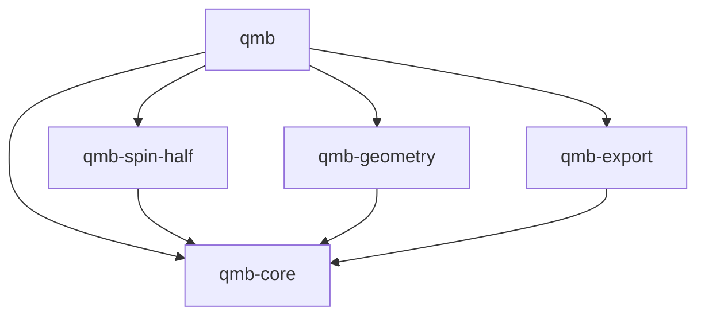

# qmb-rs 実装計画

更新日: 2026-10-22

## 1. 目的と位置付け

本書は、[要件](requirements.md)、[アーキテクチャ概要](architecture.md)、および[初期版の提供範囲と完成条件](design/initial-release.md)に基づき、合意した crate 分割・実装順序と進捗を記録する。段階1は実装済み、段階2以降は未実装である。

`qmb-core` は抽象契約と共通の代数処理を担当し、具体的な代数は専用 crate に分離する。文書中の「代数 core」は `qmb-core` を指す。共通表現と基本操作を同じ crate が所有し、内部の責任は module で分離する。

未決の公開 API・trait シグネチャ、共有の内部表現、評価手順、数値 backend、および追加依存ライブラリは、各実装段階に入る前に設計する。`Arc` の採用と状態式の `act`・`evaluate` の役割は確定事項とし、数学的契約と初期版の提供範囲は既存文書に従う。

## 2. crate の責任と依存関係

初期版は以下の5 crate を `crates/` 以下に配置し、package 名は表の名称とする。現時点で実装済みの crate は `qmb-core` と `qmb-spin-half` である。

| crate | 責任 | workspace 内の通常依存 |
| --- | --- | --- |
| `qmb-core` | 数値精度・局所構造・primitive・基底の契約、有限線型結合、局所・複合式木、Index・自由度・Hilbert 空間、局所式の配置・束縛、評価、基底展開・座標取得・写像の表現係数 | なし |
| `qmb-spin-half` | spin-1/2 の局所構造、状態・演算子 primitive、局所規則、状態基底と二種類の演算子基底 | `qmb-core` |
| `qmb-geometry` | Geometry・Site、Chain、近接関係、自由度と Site の対応付け、配置用 Index 発行の補助 | `qmb-core` |
| `qmb-export` | 外部数値ライブラリへの密・疎変換、空間・基底・精度情報との対応付け | `qmb-core` |
| `qmb` | 各 crate の再公開、モデル構築補助、利用例、縦断的な結合テスト | 上記4 crate |

以下の矢印は「依存する」を表す。

将来の別の具体的代数も、専用 crate として `qmb-core` の契約を実装し、共通型を直接利用できる。初期版には未実装の代数用 crate を作らない。core は具体的代数を列挙せず、独自代数も同じ式木・評価機構で扱う。core の通常依存に具体的代数・Geometry・数値 backend を持ち込まない。

`qmb` は core・共通代数処理・spin-1/2・Geometry を既定で再公開する。数値 export は `export` feature で有効にし、数値 backend に依存せず代数計算だけを利用できる構成にする。初期版の export は一つの crate にまとめ、backend ごとの crate 分割は行わない。

## 3. 抽象契約と共通実装の境界

### 3.1. qmb-core

共通の代数処理を追加した後も `no_std + alloc` を維持する。Step 2 は既存の依存と標準機構で実装し、新しい production 依存や feature は追加しない。

局所構造の次元・一致条件・primitive の関連付け、内積・Product・Act・随伴・trace・恒等元、および基底の展開・順序番号・列挙の契約を置く。Act は状態 primitive が演算子 primitive の作用を受ける能力とする。

局所契約・有限線型結合、局所・複合式、Index・空間、配置・束縛、評価、および基底処理を module で分離する。基底 trait と primitive 一つの展開から、式全体の展開・複合基底・座標取得までを core が担当する。外部の数値コンテナ型は必須 API に持ち込まない。

Step 1 の局所規則は `LinearCombination` を返す。Step 2 では、有限線型結合・式木・局所規則の返却形式を一体で再設計する。共通処理のために独立した線型表現を重ねず、primitive と式の接続を整理する。crate の統合だけで要素型変換が消えるとはみなさず、具体的な型・返却形式・取り込み方法は未決とする。

不変な式節点・primitive は `Arc` を基本として共有する。共通評価は線型性・共役線型性・合成則から primitive の規則へ委譲する。状態式の `act` は `Act` 節点による遅延構築、`evaluate` は基底を指定しない局所規則による評価とする。通常の作用・内積・trace に、指定基底への展開や行列化を必須としない。

### 3.2. 具体的代数

`qmb-spin-half` は primitive・局所規則・具体的基底を実装し、core の共通型を直接利用できる。具体的代数やユーザに独自の式木・evaluator の実装を要求しない。

初期版は一つの系を同じ局所構造型 `L` の基本因子で構成し、その系では対応する primitive 型を共通にする。独自代数は `L` の別実装として別の系で単独利用する。異種局所構造の混在・合成と、そのための型消去・保持方式の設計は後続へ延期する。

### 3.3. Geometry・export・利用窓口

Geometry は局所代数の種類を知らず、Site・関係・配置を担当する。Heisenberg Hamiltonian と Neel 状態の構築補助は `qmb` のモデル構築 module に置く。

代数的な座標取得と写像の表現係数の生成は `qmb-core`、外部のベクトル・行列型への格納は `qmb-export` が担当する。core での局所式への Index 付与・束縛と、Geometry での自由度と Site の対応付けを区別する。

`qmb-export` は公開された基底列挙・作用・座標取得を使い、非公開の式木へアクセスしたり、評価規則を再実装したりしない。非正規直交基底では内積値と座標を区別する。演算子の export に演算子基底への全展開を必須としない。

## 4. 実装順序と完了条件

crate ごとに完成させるのではなく、抽象契約と具体的代数を往復しながら動作範囲を広げる。

| 段階 | 実装内容 | 完了条件 |
| --- | --- | --- |
| 1. 抽象契約と具体例（実装済み） | `qmb-core` と `qmb-spin-half`。能力 trait、有限線型結合、spin の局所規則・基底 | core の公開契約だけで spin の積・作用・随伴・内積・trace・基底展開を記述できる |
| 2. 局所式と評価 | `qmb-core` で有限線型結合・式木・局所規則の返却形式を一体で設計し、共通局所式・共有・評価を実装する | lazy な構築、`act` のチェーンと基底を指定しない `evaluate` が動き、入力の不変性と共有を検証できる |
| 3. 空間と複合評価 | `qmb-core` に Index、自由度、同じ局所構造の因子による入れ子空間、互換性・部分系判定、配置・束縛、複合作用・内積・期待値・full trace | Geometry なしで同種の複数因子を評価でき、zero・identity の空間保持と明示空間の優先を検証できる |
| 4. 最初の縦断例 | `qmb-geometry` と `qmb`。Chain、配置、Heisenberg・Neel の構築 | 行列化せず open chain の期待値 `−J(L−1)/4` を得る。0-site と periodic の小規模規約も確認する |
| 5. 縮約・座標取得 | `qmb-core` に partial trace、複合基底、式の展開・再展開・係数取得、写像の表現係数 | 残存空間、mixed-radix 順序、非正規直交基底、入力ごとの共役指定を正しく扱える |
| 6. 数値接続と受入確認 | `qmb-export`。密ベクトル・密行列、続いて疎ベクトル・疎行列を接続し、利用例を完成させる | 代数計算・表現係数・密・疎の各経路が一致し、疎変換が密表現を中間生成せず、初期版の完成条件を満たす |

段階1で非公開テスト用の別の有限次元局所代数も用意し、契約が spin 固有になっていないことを確認する。段階2以降、その代数だけで構成する独立した系に対し、共通式・複合評価・基底展開・export の検証を順次追加する。spin と同じ系に混在させる検証は初期版に含めない。抽象化の問題を最終段階まで持ち越さない。

段階4の解析的期待値は実数の `J` と `L >= 1` を対象とし、0-site は Hamiltonian と期待値が zero となる特例として検証する。各段階の詳細な能力・受入条件は既存の設計文書に従い、表に記載していない導出操作も初期版の範囲から除外しない。

### 4.1. 段階1の実装・検証状況

2026-10-21 に段階1の完了条件を満たすことを確認した。

- `qmb-core` に局所構造・演算・基底の trait と有限線型結合を実装した。局所構造は型ごとの固定次元・静的な関連付けを採用し、実行時の定義パラメータや別実装型間の定義照合は対象外とした。
- `qmb-spin-half` に状態・演算子 primitive、局所規則、状態基底と二種類の演算子基底を実装した。通常依存は `qmb-core` のみである。
- 単精度・倍精度で局所積36組、作用12組、内積・随伴・trace・基底展開を独立した行列と照合した。core の公開 API だけを使う三次元局所代数、非正規直交基底、操作ごとの最小限の型制約もテストした。
- 既存の direnv 環境（Rust 1.98.0）で workspace の全26テスト（doc test 含む）、format check、Clippy、警告をエラーとするドキュメント生成が成功した。
- 両 crate は `no_std` を指定し、通常依存で `std`・`libm` が有効になっていないことを確認した。宣言した MSRV（Rust 1.85）での実行と、`std` のない target 向けビルドは、対応環境がないため未確認である。

## 5. 検証方針

- `qmb-core` では共通型・契約・評価、具体的代数では局所規則、`qmb` では crate を横断する利用を検証する。
- `qmb-core` の拡張性は integration test から公開 API だけを使って確認する。通常依存に具体的代数を追加しない。
- 小規模行列を独立に定義し、製品用 export の実装前から参照計算に使う。単精度・倍精度それぞれで `atol`・`rtol` を明示する。
- 非正規直交基底、重複 Index、空間・精度の不整合、不正な縮約・配置、zero-norm、空・単因子・入れ子を検証する。
- 入力の不変性、共有実体の再利用、不要な局所規則が呼ばれないことを検証し、lazy 評価と不要な deep copy の抑制を確認する。source の自動保持、式の構造比較・表示は受入条件に含めない。
- 各段階で対象テストを実行した後、workspace の test・format check・Clippy で確認する。最終段階では export 無効と全 feature 有効の両構成を確認する。
- 初期版の代表シナリオを実行可能な利用例として提供する。

## 6. 未決事項と延期するもの

有限線型結合・式木・局所規則の返却形式の具体的な接続、局所構造の定義の識別方式、Index の生成方式、共有の内部表現、評価手順、数値 backend と外部依存は、各実装段階に入る前に設計する。`Arc` の採用、状態式の `act`・`evaluate` の役割は確定事項とする。異種局所構造の保持・型消去は初期版の設計対象に含めない。新しい production 依存は、採用理由と用途を具体化してから確認する。

初期版は同種局所構造・ordinary・単一スレッドを対象とする。異種局所構造の混在・合成、Graded・fermion、source の自動保持・式の構造比較・表示、保存・復元、個別の簡約ルール、キャッシュ、並列化、追加 Geometry、ML・tensor network などの接続は既存の初期版設計に従って延期する。これらのための crate は先に作らない。不変実体の共有と後続機能の数学的契約は維持する。
